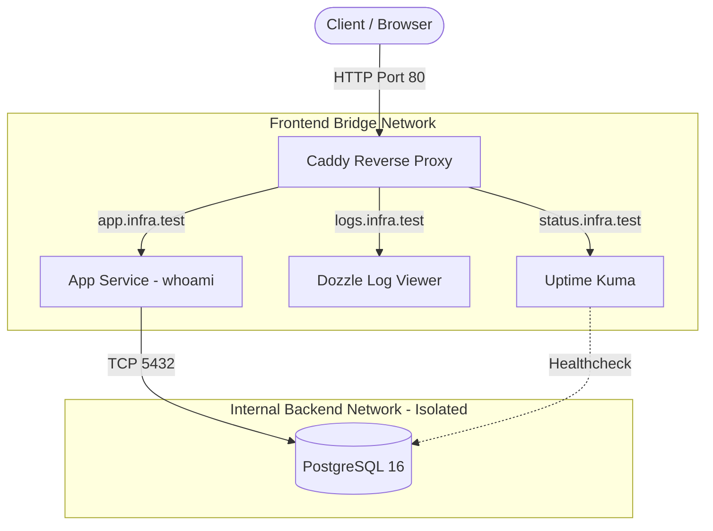

# 🛡️ Stratum OPS

Modular, security-first container infrastructure blueprint built with **Docker Compose** and **Caddy**. Designed to demonstrate production-grade network segmentation, single-entrypoint reverse proxying, and centralized observability on a local machine or VPS.

## 🏗️ Architecture & Network Topology



## ✨ Key Infrastructure Principles

- **Single Entrypoint:** Only Caddy exposes ports (`80`/`443`) to the host machine.
- **Strict Network Segmentation:** Database workloads live inside an `internal: true` bridge network (`backend_net`), completely unreachable from the reverse proxy or external host network.
- **Secret Decoupling:** Zero hardcoded credentials in `compose.yaml`; environment variables are injected via `.env`.
- **Built-in Observability:** Real-time container log streaming via **Dozzle** and service health tracking via **Uptime Kuma**.

## 🚀 Quick Start

1. **Clone & configure environment:**

   ```bash
   git clone [https://github.com/](https://github.com/)<username>/stratum-ops.git
   cd stratum-ops
   cp .env.example .env
   ```

2. **Add local DNS entries to `/etc/hosts`:**

   ```text
   127.0.0.1 app.infra.test logs.infra.test status.infra.test
   ```

3. **Launch the stack & verify network isolation:**
   ```bash
   make up
   make verify-isolation
   ```
